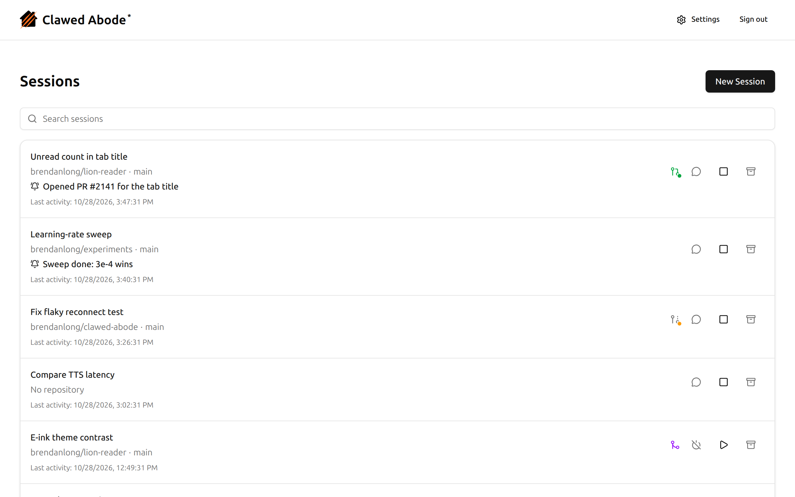
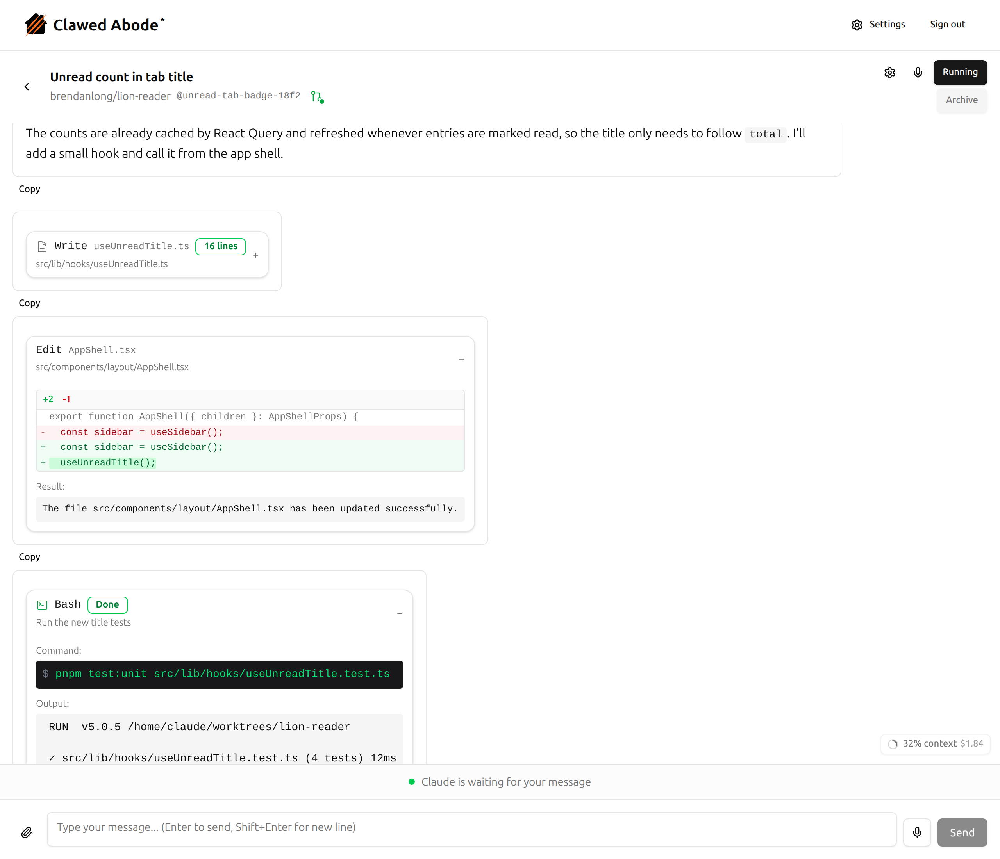
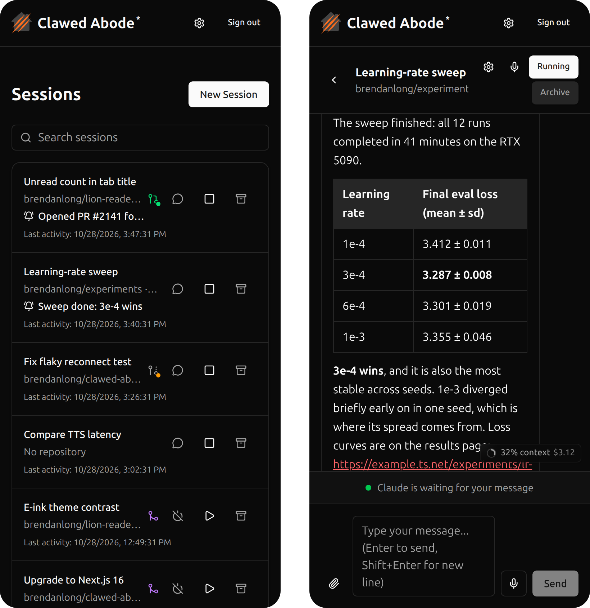

# Clawed Abode

Run Claude Code on your own machine and use it from your phone. Clawed Abode is a self-hosted web app: start sessions on any of your GitHub repos, check on them from anywhere, and answer when an agent needs you. Agents work directly on your hardware, GPU included.

> **Note:** This is an unofficial community project and is not affiliated with, endorsed by, or supported by Anthropic. [Claude Code](https://claude.ai/code) is a product of Anthropic, but this web interface is an independent project.

Read more: [Clawed Abode: Claude Code is Too Cloudy](https://www.brendanlong.com/claude-code-is-too-cloudy.html)

## What you can do

- **Keep many agents busy at once.** Each session gets its own clone of a repo and branch, so agents never step on each other. Start one from a GitHub issue, or with no repo at all for research and one-off tasks. The session list shows each session's pull request and CI status at a glance.
- **Use your own machine.** Agents run on your server with your installed tools, your data and your GPU, so they can train models, run long experiments or use anything Claude Code on the web can't reach.
- **Walk away.** Sessions keep running when you close the tab, lose signal or restart the server. When an agent finishes or needs a decision, it tells you: a notification, and a one-line summary in the session list. Answer its questions and approve or revise its plans from your phone.
- **See what the agent did.** Every command, edit and test run is in the transcript, with diffs and output a tap away, plus how much each turn cost and how full the context window is.
- **Talk instead of type.** Dictate prompts, and have replies read aloud in a natural voice, with lock-screen media controls.
- **Hand over files and get some back.** Attach screenshots, PDFs or data to a prompt. Agents can publish HTML reports and plots at a stable link for you to open in the browser, and an optional VS Code button opens a session's files in a browser editor.
- **Set it up once per repo.** Give each repo (or every session) its own environment variables, secrets, MCP servers, custom instructions and default model. Sessions can also run OpenAI GPT models through a LiteLLM proxy.
- **Let agents work together.** Sessions can message each other, watch pull requests and security alerts without polling, and pause automatically when your Claude subscription is close to its usage limit, picking back up when it resets.

## Security

**Agents run in Claude Code's `bypassPermissions` mode**: they execute code, install packages and change files without asking. Sessions are separated only by convention: they share one user account and can see each other's files. So:

- **Run it on a dedicated machine or a dedicated user account**, not your personal workstation, and never as root.
- **Use a fine-grained GitHub token** scoped to only the repositories you want agents to reach.
- **Reach it over [Tailscale](https://tailscale.com/)** or similar; never expose the app's port directly to the internet.

[`doc/security.md`](doc/security.md) covers authentication, prompt-injection handling and secret redaction.

## Self-hosting

Clawed Abode needs a Linux machine with systemd and a Claude subscription. It runs as one Node.js process with a SQLite database, as a systemd user service, behind Tailscale Serve. Read-aloud, GPT models, the VS Code button and published files are optional and switch on when you configure them.

The [self-hosting guide](doc/self-hosting.md) walks through setup, updating, the optional services and every setting.

## Development

`pnpm run dev` starts the dev server with hot reload; `pnpm test:run` runs every test suite (what CI runs). After editing `prisma/schema.prisma`, `pnpm run db:migrate` creates and applies a migration (production applies them with `prisma migrate deploy` via `scripts/update.sh`). `pnpm readme-screenshots` regenerates the screenshots above from a throwaway demo instance. Contributor rules and the design docs are in [`CLAUDE.md`](CLAUDE.md) and [`doc/DESIGN.md`](doc/DESIGN.md).

## License

[MIT](LICENSE)
